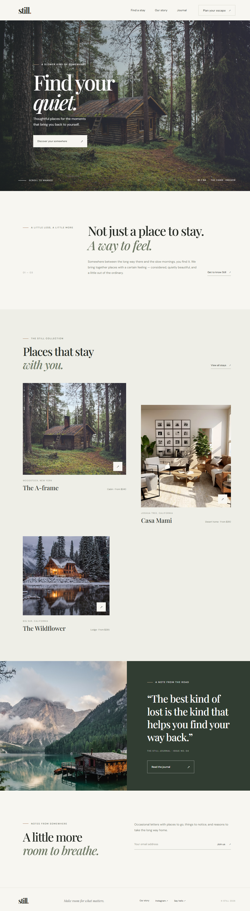

# Still — Find your quiet

**Still** is a responsive landing page concept for a thoughtfully curated collection of places to stay. Its editorial design pairs quiet typography, nature-inspired colors, and destination photography to invite visitors to slow down and find a place that feels like theirs.

This project is built with plain HTML, CSS, and JavaScript. There is no framework, build step, or package installation required to view the page.



## Contents

- [Highlights](#highlights)
- [Project structure](#project-structure)
- [Run locally](#run-locally)
- [Page sections](#page-sections)
- [Interactions](#interactions)
- [Responsive behavior and accessibility](#responsive-behavior-and-accessibility)
- [Assets and external services](#assets-and-external-services)
- [Limitations](#limitations)

## Highlights

- A full-width photographic hero with a clear introduction and call to action.
- An editorial brand introduction and a staggered collection of featured stays.
- A scenic journal feature, newsletter sign-up, and compact footer.
- Responsive layouts for desktop and mobile screens.
- A small, dependency-free JavaScript file for navigation and newsletter form interactions.
- Support for the operating system's reduced-motion preference.

## Project structure

```text
.
├── index.html      # Semantic page markup and content
├── styles.css      # Visual styles, responsive layouts, and motion
├── script.js       # Mobile navigation and newsletter demo behavior
├── README.md       # Project documentation
└── screenshot.png  # Full-page desktop screenshot
```

## Run locally

### Open directly

Open `index.html` in a modern web browser. No install or build command is necessary.

### Serve from a local web server

From the project directory, start a static server:

```sh
npx serve .
```

Open the local URL printed by the server in your browser. A local server is useful for checking the page as a website rather than opening the HTML file directly. The `npx` command may prompt to download `serve` if it is not already available.

## Page sections

1. **Hero** — introduces Still with the headline “Find your quiet,” destination photography, and a link to explore stays.
2. **Introduction** — describes the feeling and point of view behind the collection.
3. **Featured stays** — presents three sample properties with photographs, locations, categories, and indicative starting prices.
4. **Journal feature** — pairs a landscape image with a short editorial quotation.
5. **Newsletter** — invites visitors to subscribe for occasional travel notes.
6. **Footer** — provides brand, navigation, social, and contact links.

## Interactions

- On small screens, the navigation button opens and closes the menu. Selecting a navigation link closes the menu again.
- The newsletter form uses the browser's built-in email validation. On a valid submission, it displays a confirmation and clears the field.
- Stay cards and calls to action include links to page sections or example destinations.

## Responsive behavior and accessibility

- The layout adapts at a mobile breakpoint, rearranging the stay cards, content sections, and navigation for narrower screens.
- Navigation and form controls use semantic HTML, accessible names, and a live status message for newsletter feedback.
- Content images include descriptive alternative text.
- The page honors `prefers-reduced-motion` by reducing animation and transition effects.
- Smooth scrolling is enabled by default and disabled when reduced motion is requested.

## Assets and external services

- The typefaces are loaded from Google Fonts.
- Photographs are loaded from Unsplash image URLs.
- An internet connection is needed to load these external fonts and images. If an external asset is unavailable, the page's text and layout remain available.
- The page itself does not use a JavaScript framework or external runtime library.

## Limitations

This is a front-end landing page concept. The newsletter form displays a local confirmation only; it does not send or store email addresses. Property cards and navigation links are illustrative and are not connected to a booking platform or a live property catalog.
